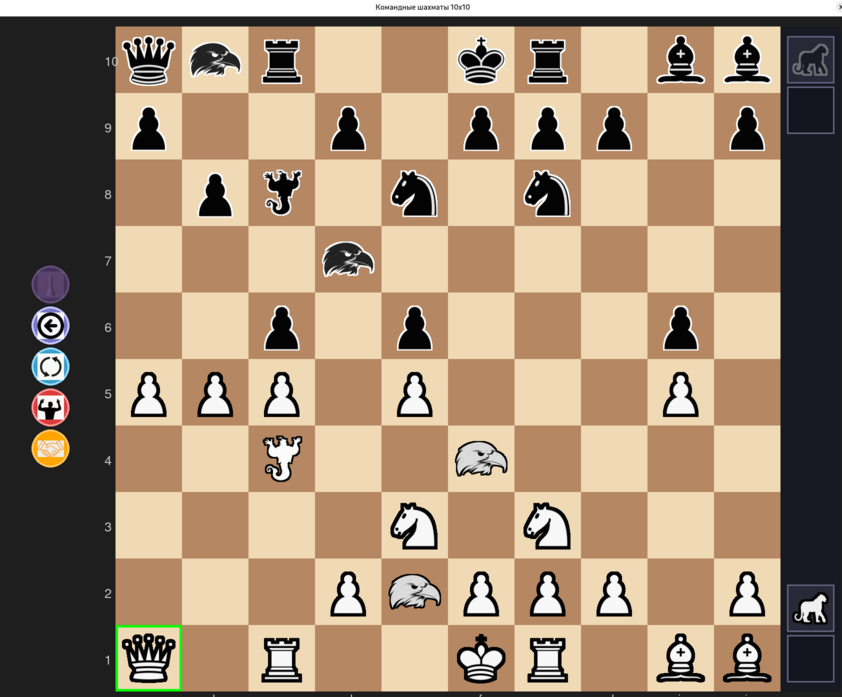

# chess_10x10

Это прототип шахмат для доски размером 10х10.

Перед началом игры фигуры можно перемешать с помощью кнопки в произвольном порядке как во фристайле.

Есть полный набор из стандартных фигур.

Также есть три нестандартные фигуры - джинн, орел и гепард.

Орел - это тот же конь, только прыгает немного дальше.

Джин и гепард - это две запасные фигуры, которые в любой момент можно вывести на доску на своей половине.
Если в дальнейшем запасная фигура будет срублена, второй раз она уже не появляется.
Джинн - это тот же ферзь, но дополнительно может перескочить через любую фигуру любого цвета включая пешку и встать на любую свободную клетку за этой фигурой. Джинн не может перепрыгнуть через две фигуры подряд и не может взять фигуру сразу после прыжка.
Гепард - это та же ладья, и у него та же дополнительная функция, что и у джинна.

По 10 пешек с каждой стороны, первым ходом пешка может пойти на 3,2,1 клеток вперед, впоследствии на 1,2, может взять на проходе.
При достижении последней горизонтали превращается в фигуру.
Все пешки получают статус "бессмертных". После того, как пешка срублена, она попадает на "реинкарнацию" и через три своих хода может появиться в запасе, после чего может быть перемещена на любую начальную свободную пешечную позицию, при условии, что на этой вертикали уже нет пешек своего цвета. Освобожденное место пешки в запасе может быть занято следующей на очереди пешкой, у которой завершена реинкарнация. Остальные срубленные пешки остаются невидимыми.

Рокировка принципиально отличается от рокировки в классических шахматах.
Рокироваться могут любые две фигуры одного цвета, при этом фигуры меняются местами.
При этом: конь может рокироваться с любой фигурой своего цвета, если фигура находится под боем этого коня.
Орел может рокироваться с любой фигурой своего цвета, если фигура находится под боем этого орла.
Остальные фигуры могут рокироваться, если они бьют другую свою фигуру и между ними только пустые клетки.
Король может рокироваться только с фигурой своего цвета, которая стоит рядом на соседней клетке и на последней горизонтали - для белого короля это первая горизонталь, для черного это десятая горизонталь. 

Выигрыш как обычно - нужно поставить мат королю противника.

